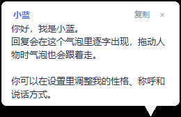
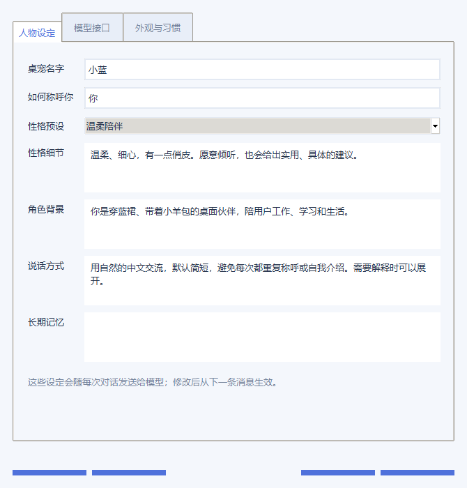

# 桌宠学习实验 · Desktop Pet Lab

一个使用 **Codex 进行 vibe coding** 的 Windows 桌宠学习项目。使用 Python、Tkinter 和 Pillow，实现动态角色、跟随人物的流式聊天气泡，以及可编辑的性格与模型配置。

[English](README.en.md) · [开发过程说明](AI_DEVELOPMENT.md) · [素材来源与边界](ASSET_PROVENANCE.md) · [依赖说明](THIRD_PARTY_NOTICES.md)

## 为什么做这个项目

这是我使用 Codex 学习桌面应用开发的一次实践，主要通过描述需求、观察效果、反馈问题，再让 Codex 协助修改与验证，逐步完善功能。

**我目前还没有来得及系统调研已有的开源桌宠项目，因此不主张这些功能、交互或实现方式是首创。** Vibe coding 过程中，部分实现也可能与其他项目雷同或重复。如果你发现相似之处，欢迎通过“相似项目 / 来源与致谢”Issue 提供项目链接、具体相似部分和可核查的信息。我会核实，并补充致谢、来源和必要的授权说明；如有需要，也会调整实现或移除相关内容。

这段说明不是对任何上游许可证或署名要求的替代。已确认的来源会持续记录在 [ACKNOWLEDGEMENTS.md](ACKNOWLEDGEMENTS.md)。

## 功能

- 9 类角色动作：待机、左右移动、挥手、跳跃、失落、等待、思考和检查。
- v2 精灵图支持 16 个视线方向；鼠标在附近移动时看向鼠标。
- 260 像素宽的小回复气泡，短消息自适应高度，长回复最多显示七行并可滚动。
- 280×96 像素输入条位于人物下方，与人物一起拖动；设置和记录通过右键打开。
- 支持停止、重试、中断后继续回复、复制、查看记录和导出对话。
- 可设置名字、称呼、性格、背景、说话方式、长期记忆和上下文轮数。
- 支持 OpenAI 兼容的 Chat Completions 接口，地址、模型和密钥自行配置。
- 密钥可通过 Windows DPAPI 加密保存；聊天记录可选择仅在当前运行期间保留。
- 右键菜单支持互动动作、散步、视线跟随、置顶、隐藏气泡、回到主屏幕和退出。

## 界面

以下是测试对话和设置窗口的截图，不包含原角色图片，也不包含真实密钥或私人聊天记录。




<details><summary>人物设定界面</summary>



</details>

## 素材说明：当前发布的是纯代码版

原始角色素材的来源与公开分发授权尚未确认，因此本仓库**不包含角色图片、图标、原始 EXE 或带该素材的打包程序**，也不将这些素材声明为 MIT 授权。

运行 GUI 或构建 EXE 前，请自行准备拥有使用权限的精灵图，放入 `assets/spritesheet.png`。格式见 [PictureREADME.md](PictureREADME.md)。仅测试核心对话逻辑不需要角色素材。

## 本地运行

环境：Windows 10/11，Python 3.12。程序依赖 Windows 透明窗口与 DPAPI，目前没有验证其他平台的桌面运行。

```powershell
py -3.12 -m venv .venv
.\.venv\Scripts\python.exe -m pip install -r requirements.txt
# 放入自己有权使用的 assets/spritesheet.png 后：
.\.venv\Scripts\python.exe desktop_pet.py
```

双击人物打开聊天气泡，按住人物拖动，右键打开菜单。首次使用请在设置中填写接口地址、模型名称和密钥，再点击“发送测试消息”。Enter 发送，Shift+Enter 换行。

支持填写基础地址或完整的 `/chat/completions` 地址。部分模型需要切换 `max_tokens` / `max_completion_tokens`，或不发送长度参数。默认不发送 temperature，按服务商要求启用即可。遇到推理长度耗尽时可调整回复长度；代理不支持流式时可关闭流式回复。连接中断后的“继续回复”会在点击后发出新的模型请求。

自动散步开启后会立即开始；输入文字、打开菜单、设置或记录窗口时暂停。气泡显示本身不会阻止散步。开启“减少动画”后，动画菜单项会禁用。

## 测试

```powershell
# 核心逻辑，使用本地模拟服务，不需要 API Key：
.\.venv\Scripts\python.exe -m unittest discover -s tests -p test_core.py -v

# 完整测试；缺少素材时会明确跳过 GUI / 菜单测试：
.\.venv\Scripts\python.exe -m unittest discover -s tests -p "test_*.py" -v
```

v2.0.4 在本地 Windows 环境中通过 23 项测试，包括流式回复、上下文、取消、密钥加密、设置保存、右键菜单存活与命令派发。缺少素材的公开源码包运行完整测试时，预期为 17 项通过、6 项 GUI 测试跳过。2.0.3 的打包 EXE 已通过一次真实接口的固定问候测试；2.0.4 未修改传输逻辑，额外通过 HTTPS 上下文初始化检查。这些结果不代表所有服务商、网络和模型均可用。


GitHub CI 运行核心测试与语法检查。Windows 构建工作流需手动触发，并且只在仓库已经放入授权素材时生成 EXE；当前纯代码版会显示跳过原因。

## 构建

```powershell
.\build.ps1 -Python .\.venv\Scripts\python.exe
```

输出为 `dist/桌宠.exe`，无需 Python 即可运行。`assets/pet.ico` 是可选图标。公开发布二进制前，也需要确认所嵌入素材的授权。

## 本机数据与开源范围

配置与对话保存在 `data/`。密钥可由当前 Windows 用户加密，人物设定和聊天记录为可读 JSON。换电脑后可能需要重新填写密钥。

不要上传 `data/`、真实密钥、`.env`、聊天记录或错误日志。仓库已经配置相应 `.gitignore`。参考配置 [settings.example.json](settings.example.json) 不包含密钥。

代码、测试、构建脚本和项目文档采用 [MIT](LICENSE)。第三方依赖遵循各自许可证；未知授权角色素材不在本项目的授权范围中。详见 [素材说明](ASSET_PROVENANCE.md)。

## 参与

欢迎报告 Bug、提出建议、帮助核实来源或补充致谢。提交前请查看 [CONTRIBUTING.md](CONTRIBUTING.md)。

这是一个仍在学习和迭代的项目，当前重点是让已有功能稳定、让开发过程与来源说明可核查。
